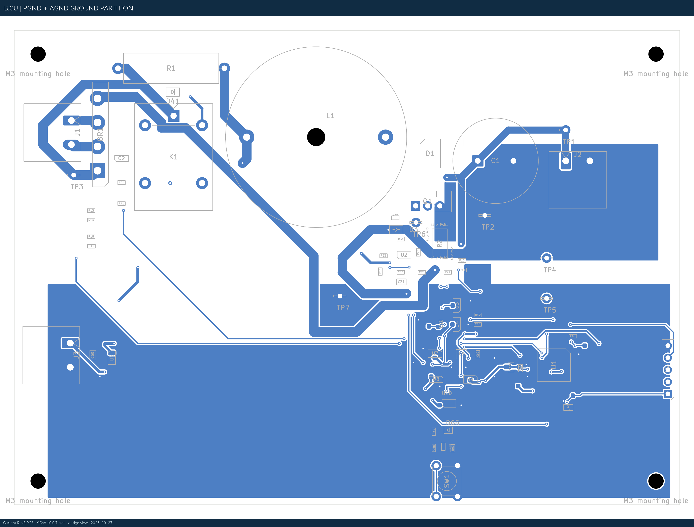

# 40 W CCM Boost PFC 项目展示总报告（RevB 最新版）

## 一页速览

20–28 Vac / 50 Hz → 40 V / 1 A / 40 W，50 kHz CCM Boost PFC。建立自主行为级双闭环 Simulink 模型、完成硬件原理图与保护链设计；本人完成 RevB 器件模块化摆放和全板手工布线，B.Cu PGND/AGND 分区覆铜已完成静态终审。**当前未下单，也没有硬件上电实测。**

| 20/24/28 Vac | Vout 平均 | PF | THD 2–40 次 | Vout 纹波 |
|---|---:|---:|---:|---:|
| 20 Vac | 39.9829 V | 0.99714 | 5.3722% | 1.5213 Vpp |
| 24 Vac | 39.9910 V | 0.99652 | 5.4714% | 1.5035 Vpp |
| 28 Vac | 39.9920 V | 0.99558 | 6.2925% | 1.4910 Vpp |

**以上全部是 Simulink 行为模型结果，不是实物测试。**24 Vac 稳态掉电后 10 ms，模型 Vout 为 35.5683 V（过零）和 35.7036 V（峰值），高于 34 V 设计下限；28 Vac 线峰有效升压余量约 1.794 V，器件级仍待验证。[原始结果](../../simulation/simulink/BoostPFC_Design/results/final_input_range/final_input_range_summary.json)、[掉电结果](../../simulation/simulink/BoostPFC_Design/results/hold_up_test/hold_up_summary.json)。

## RevB PCB 当前进度

RevB 已由项目本人完成主要功能模块器件摆放与全板手工布线，并建立 PGND/AGND 底层分区覆铜。覆铜静态专项终审为 CONDITIONAL GO：可进入最终丝印整理与新版 Gerber/Excellon 本地 CAM 审查，尚未批准直接下单。 83 封装、557 走线、81 过孔、2 zone、73 网络，0 未连接。最新 KiCad DRC 0 Error、34 Warning；4 项 PCB-only H1–H4 机械孔一致性 Warning。[完整分项](../../hardware/BoostPFC_40W_KiCad/revb_ground_final_review_2026-10-27/REVB_GROUND_POUR_FINAL_REVIEW.md)。D1 三端物理映射修复、R2 四端 Kelvin、硬件 OCP/故障锁存、MCU C40–C48 去耦与 Net Class 已纳入现版工程。

**图 1　RevB 当前真实 PCB 全板。** 由本版 `.kicad_pcb` 直接导出，不是旧 RevA Gerber。

**图 2　B.Cu PGND/AGND 分区覆铜。** NT1 静态单点连接 PASS；两网各有两个填充连通域，不能称为完全连续地平面。

## 面试可讲的五个工程问题

1. 保存启动失败基线，由条件式旁路、100 ms 受控软启动降低行为模型启动峰值；不把 4.5 A 名义阈值说成真实峰值保护。
2. 28 Vac 线峰接近 40 V 输出，量化升压余量并保留边界风险。
3. 在 RevA 交叉审查中发现 D1 三焊盘错误映射，修改符号/封装关系后重新核查。
4. RevB 本人手工布局布线，将 R2 功率端与 Kelvin 采样双线分离，AGND/PGND 通过 NT1 静态单点连接。
5. 按 STM32G431 电源引脚补充 C42–C48，设置功率、Gate、Kelvin、模拟等网络类。

## 当前界限与下一步

先处理丝印与历史 `/RECT_IN` 悬空过孔，复跑 DRC 和机械/铜颈审查，再生成新版 Gerber/Excellon 做**本地** CAM。RevB 尚无厂家审图、裸板订单、焊接、上电、效率、PF/THD、温升、EMI、VDS 尖峰或保护动态实测。仅完成静态设计检查不构成制造或电气功能放行。

## 文档索引

- [计划书](01_项目计划书.md)；[电源设计](02_电源设计与实现报告.md)；[仿真验证](03_Simulink仿真与验证报告.md)；[PCB 工程](04_PCB设计审查与制造资料_阶段版.md)；[面试手册](05_项目总结_简历描述与面试手册.md)；[证据核对](SOURCE_AUDIT.md)。
- 本报告 PCB SHA-256 `2BB23CBACD7A38E5F8491438F23DFACB0250224D6A2BCA3105C27D4691244414`；SCH SHA-256 `2C48EE15A7AB56400A25E550534BDA38973D15C336F68315AF6E2D29CF0975B0`。仅作为证据定位，实际设计以原文件为准。
