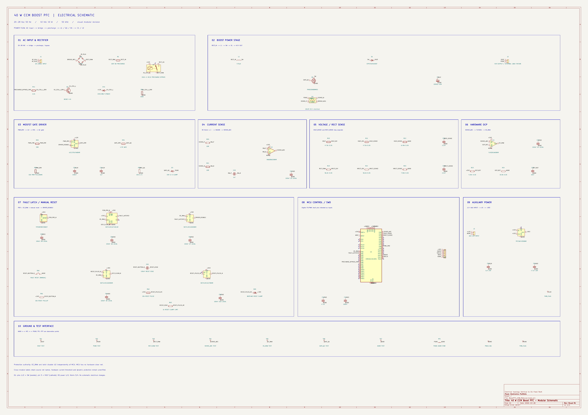

# 40 W CCM Boost PFC 电源设计与实现报告

版本：2026-10-27 文档整理版。**“实现”指已建成行为模型、原理图和历史 RevA PCB 文件；不指已制成并验证实物。** 本文以 [初始化脚本](../../simulation/simulink/BoostPFC_Design/BoostPFC_Design_Init.m)、[最终模型初始化](../../simulation/simulink/BoostPFC_Design/BoostPFC_Design_LoadConnection_Init.m)、[设计记录](../../simulation/simulink/BoostPFC_Design/DESIGN_NOTES.md) 及 [D1 原理图](../../hardware/BoostPFC_40W_KiCad/pcb_revA_2026-10-26_d1fix/BoostPFC_40W_RevA.kicad_sch) 为依据。

## 1. 拓扑与能量流


**图 1　40 W CCM Boost PFC 功率主电路与平均电流模式双闭环控制架构。** 主功率回流串接低边分流电阻 Rs（对应原理图四端 Kelvin 采样电阻 R2），电压外环 Gcv(s) 输出幅值指令 Im 与归一化全波整流包络 in*(t) 相乘生成正弦半波电流参考 iref(t)，经电流内环 Gci(s) 与 50 kHz PWM 调制驱动 Q1。



**图 2　40 W Boost PFC 模块化原理图。** 可放大查阅 [原 PDF](../../hardware/BoostPFC_40W_KiCad/schematic_modular_2026-10-26/BoostPFC_40W_Modular.pdf)。

```text
交流输入 → BR1 全桥 → RECT_RAW → R1/K1 → RECT_IN → L1 → SW
                                                      ├─ Q1 导通 → R2 → BR1 负端
                                                      └─ D1 导通 → C1、J2 → 负载
```

Q1 导通时，L1 由整流电压储能，D1 反偏，C1 向负载供能；Q1 关断时，L1 电流经 D1 给 C1 与负载供能。电压外环调整输入电流幅值，电流内环让参考随整流输入包络变化，以提高输入 PF。模型在主要传功区按 CCM 设计，工频过零附近 iL 可降至零，不能宣称整个周期严格连续。

## 2. 规格、假设和参数

| 项目 | 当前值与来源 |
|---|---|
| 输入/输出 | 20–28 Vac RMS、50 Hz；40 V、40 Ω、40 W，额定输入 24 Vac |
| PWM / 数值步长 | 50 kHz；`Ts_sim=1/(20f_sw)=1 µs`，固定步长离散求解器 |
| 功率级 | L1=470 µH、C1=2200 µF、R1 预充=10 Ω |
| 行为模型导通假设 | 桥每只二极管 0.70 V，Boost 二极管 0.65 V，Q1 40 mΩ，L1 100 mΩ |
| 尚未进入行为模型 | 反向恢复、结电容/寄生、磁饱和及铁损、电容 ESR/ESL、温度相关参数、真实驱动延迟 |

上述行为参数来自初始化脚本，不可混同于实际已选器件的全部数据手册参数。原理图中的 K2 已移除，40 Ω 动态负载由外部工装承担；见 [设计记录](../../hardware/BoostPFC_40W_KiCad/prelayout_convergence/DESIGN_RECORD.md)。

## 3. 参数计算与公式

### 3.1 输出负载与基本升压余量

额定电流 `Iout=Pout/Vout=40 W/40 V=1 A`，额定电阻 `Rload=Vout²/Pout=40 Ω`。其中 `Pout` 为负载功率，`Vout` 为稳态输出电压。理想整流峰值 `Vpk=√2·Vac,rms`；考虑模型两只桥二极管导通时，`Vrect,pk≈√2·Vac,rms-2Vf,bridge`。`Vf,bridge` 是每只桥二极管正向压降。28 Vac 的理想峰值约 39.60 V，与 40 V 输出仅差约 0.40 V；模型中的实际整流峰值约 38.198 V，稳态平均 Vout 与之差约 1.794 V。真实器件压降、波形和容差会改变此边界，故不能仅凭额定 Vout 判定可控裕量充分。

理想 Boost 关系 `Vout≈Vrect/(1-D)`，即 `D≈1-Vrect/Vout`，`D` 为导通占空比，`Vrect` 为该工频相位的整流瞬时电压。该式假定 CCM、无损耗且未限幅，仅用于解释趋势，不直接替代开关模型测量值。28 Vac 线峰处实测模型平均占空比约 5.369%，最小约 3.221%，见 [输入范围结果](../../simulation/simulink/BoostPFC_Design/results/final_input_range/final_input_range_summary.json)。

### 3.2 电感

开通期间的一阶纹波估算为 `ΔiL,on≈Vrect·D/(L·f_sw)`。`ΔiL,on` 是一个开关周期内开通段电感电流增量，`L` 为电感，`f_sw` 为开关频率；前提是该周期内整流电压近似不变、电感未饱和。**470 µH 是初始设计选值，不应写成已经由完整磁芯损耗、峰值温升和容差推导出的最优值。** 早期 24 Vac 模型在线峰附近测得开关纹波约 0.325 App，见 [旧额定工况结果](../../simulation/simulink/BoostPFC_Design/results/nominal_24Vac_metrics.json)；最终模型的 20/24/28 Vac 全周期最大 iL 为 3.421/2.835/3.968 A，见 [最终 JSON](../../simulation/simulink/BoostPFC_Design/results/final_input_range/final_input_range_summary.json)。Bourns 1140-471K-RC 官方额定筛查及铜损见 [功率热审查](../../hardware/BoostPFC_40W_KiCad/prepcb_risk_review_2026-10-26/POWER_THERMAL_REVIEW.md)；实物温升和磁芯损耗未验证。

### 3.3 输出电容、纹波和保持时间

单相输入功率含 `2f_line` 分量。对小纹波近似，`C_ripple,min≈Pout/(2π f_line Vout ΔVpp)`，其中 `ΔVpp` 为允许的输出峰峰值纹波。取 40 W、50 Hz、40 V、2 Vpp 得约 **1591.5 µF**；该式忽略 ESR、波形高次成分和控制影响，不是电容寿命评估。选用 2200 µF 后，最终行为模型 20/24/28 Vac 纹波分别为 1.521/1.503/1.491 Vpp。

恒功率负载的理想掉电关系为 `Cmin=2Pout·th/(V1²-V2²)`：`th` 是要求维持的时间，`V1` 是掉电起点电容电压，`V2` 是允许终点电压。40 W、10 ms、40→34 V 得 **1801.8 µF**；2200 µF 的理想恒功率保持时间 `th=C(V1²-V2²)/(2Pout)=12.210 ms`。实际仿真是 **40 Ω 恒电阻** 而非恒功率负载，理想电阻放电时间 `th=Rload·C·ln(V1/V2)=14.302 ms`（从精确 40 V 起算）。这解释了两种理论时间不能混用。[掉电结果](../../simulation/simulink/BoostPFC_Design/results/hold_up_test/hold_up_summary.json) 记录了实际零点/峰值工况。C1 的 ±20% 容差、ESR、寿命与纹波电流仍待验证。

## 4. 双闭环、启动与保护

电流参考形式为 `iL,ref=A_v·vrect/Vrect,pk`，`A_v` 为电压 PI 输出的电流幅值命令，`vrect` 为实时整流电压，`Vrect,pk` 为归一化峰值；该关系在参考未限幅及采样有效时成立。电流 PI 根据 `iL,ref-iL` 调整占空比，PWM 比较器驱动 Q1。一般 PI 形式 `u(t)=Kp·e(t)+Ki·∫e(t)dt`，`e` 是参考减反馈，`u` 是控制输出，`Kp/Ki` 是比例/积分系数；具体量纲还取决于模型中电流、调制和采样信号的缩放。最终模型电压 PI `Kp=0.2606491324`、`Ki=2.4565601983`；电流 PI `Kp=0.2214822821`、`Ki=695.8071103`；占空比 0～0.95，两环使用条件积分抗饱和。控制器数值可在 [环路审查 JSON](../../simulation/simulink/BoostPFC_Design/results/loop_audit/loop_audit_summary.json) 与模型初始化脚本交叉核对。

连续平均环路审查在工频线峰附近使用 `Gid(s)=Vout/(L·s+rL+Dpk·Rds,on)` 估算占空比到电感电流；其中 `s` 是拉普拉斯复频率，`rL` 为电感串联电阻，`Dpk` 为该工作点线峰占空比，`Rds,on` 为 MOSFET 导通电阻。电压对象采用 `Gvi(s)=(Vac,rms/√2)/(C·Vout·s+2Vout/Rload)`，其中 `Vac,rms` 为输入有效值、`C` 为输出电容、`Rload` 为负载；该模型来自工频平均能量平衡，外环分析还串入闭合后的电流环。它们只适用于该线性化工作点和未饱和状态，未包含精确 PWM/采样延迟，不是硬件开环传递函数实测。[完整假设与结果](../../simulation/simulink/BoostPFC_Design/results/loop_audit/loop_audit_summary.json)。

启动顺序：10 Ω 被动预充且负载断开、PWM 禁止；达到按被动预充上限推导的 98% 输出/整流门槛，同时满足 `|Vrect-Vout|≤1.5 V`、`iL≤0.25 A` 持续 0.2 ms 后旁路；待电流低于 0.10 A 后启用 PWM；100 ms 内使输出参考由当时电压升至 40 V，电流幅值参考上限由 0.5 A 升至 4.5 A；输出进入 40±0.4 V 并保持 10 ms 后直接接入 40 Ω。0.5 s 预充超时需进入安全态。参数见 [SafeBypass 初始化](../../simulation/simulink/BoostPFC_Design/BoostPFC_Design_SafeBypass_Init.m)、[ControlledStartup 初始化](../../simulation/simulink/BoostPFC_Design/BoostPFC_Design_ControlledStartup_Init.m)。

模型 **4.5 A 电流幅值参考上限** 与 **4.0 A 实际采样周期抑制、4.5 A 行为故障状态** 是不同机制。硬件原理图还有独立的 R2(10 mΩ Kelvin)→INA180A2→TLV3201→UCC27517A 禁止路径及故障锁存；静态阈值估算 4.339～4.683 A，但动态传播、采样噪声、MOSFET 关断后电感续流、上电复位时序均无硬件实测。参见 [PCB 前风险审查](../../hardware/BoostPFC_40W_KiCad/prepcb_risk_review_2026-10-26/PREPCB_RISK_REVIEW.md)。

## 5. 真实器件与待验证应力

| 功能 | 当前选型与静态依据 | 尚未验证 |
|---|---|---|
| L1 | Bourns 1140-471K-RC，470 µH；额定筛查见热审查 | 磁芯损耗、温升、机械实装 |
| Q1 | Infineon IPA052N08NM5S，80 V；模型不含开关过冲 | `VDS` 峰值、开关损耗、散热 |
| D1 | ST STPST10H100SF，100 V/10 A；物理 1/2 阳极、3 阴极 | 结温、铜皮散热、瞬态 |
| BR1 | Vishay GBU6J | 桥堆温升和安装热阻 |
| C1 | Rubycon 63PX2200MEFC18X31.5，2200 µF/63 V | 纹波频谱、寿命、容差下掉电保持 |
| R2 | Vishay WSK2512R0100FEA，10 mΩ/四端 Kelvin | 焊接、噪声、动态 OCP |
| K1 | Omron G5LE-1 DC12 预充旁路 | 40 V DC 实际切换任务与寿命 |

选型及损耗筛查的详细来源见 [功率与热审查](../../hardware/BoostPFC_40W_KiCad/prepcb_risk_review_2026-10-26/POWER_THERMAL_REVIEW.md) 和 [预布局 BOM](../../hardware/BoostPFC_40W_KiCad/prelayout_convergence/BoostPFC_40W_PreLayout_BOM.csv)。该 BOM 是工程清单，非已采购/来料合格证明。**实际效率、PF、THD、温升、开关过冲和 EMI 均未实测。**

## 6. RevB 硬件实现进度（2026-10-27 已保存快照）

RevB 已由项目本人完成主要功能模块器件摆放与全板手工布线，并建立 PGND/AGND 底层分区覆铜。覆铜静态专项终审为 CONDITIONAL GO：可进入最终丝印整理与新版 Gerber/Excellon 本地 CAM 审查，尚未批准直接下单。 [专项终审证据](../../hardware/BoostPFC_40W_KiCad/revb_ground_final_review_2026-10-27/REVB_GROUND_POUR_FINAL_REVIEW.md)核对 83 封装、557 走线、81 过孔、2 个 B.Cu 地 zone、0 未连接。R2 两条 Kelvin 线与功率端网络分离；NT1 为全板静态几何中的唯一 AGND/PGND 连接点。PGND 并非一整张不中断的底层地面，电流与噪声性能尚待实物评估。

MCU 的 C40 为 4.7 µF 储能；C41、C42、C43 分别对应 U1 的 VDD36/VSS35、VDD24/VSS23、VDD48/VSS47；C44/C45 供 VDDA/VSSA，C46/C47 供 VREF+/VSSA，C48 供 VBAT。已完成原理图补件和 PCB 手工摆件、布线；去耦效果仍需器件级测量。功率/Gate/Kelvin/模拟 Net Class 已按 [规则记录](../../hardware/BoostPFC_40W_KiCad/revb_netclass_rules_2026-10-27/REVB_NETCLASS_RULES_REPORT.md) 配置。这些为设计与静态检查结果，**不能解释为硬件性能实测**。


**图　RevB 手工布局布线与分区覆铜。** 当前 PCB 文件直接导出；仍须最终丝印、CAM 和制造审查。

