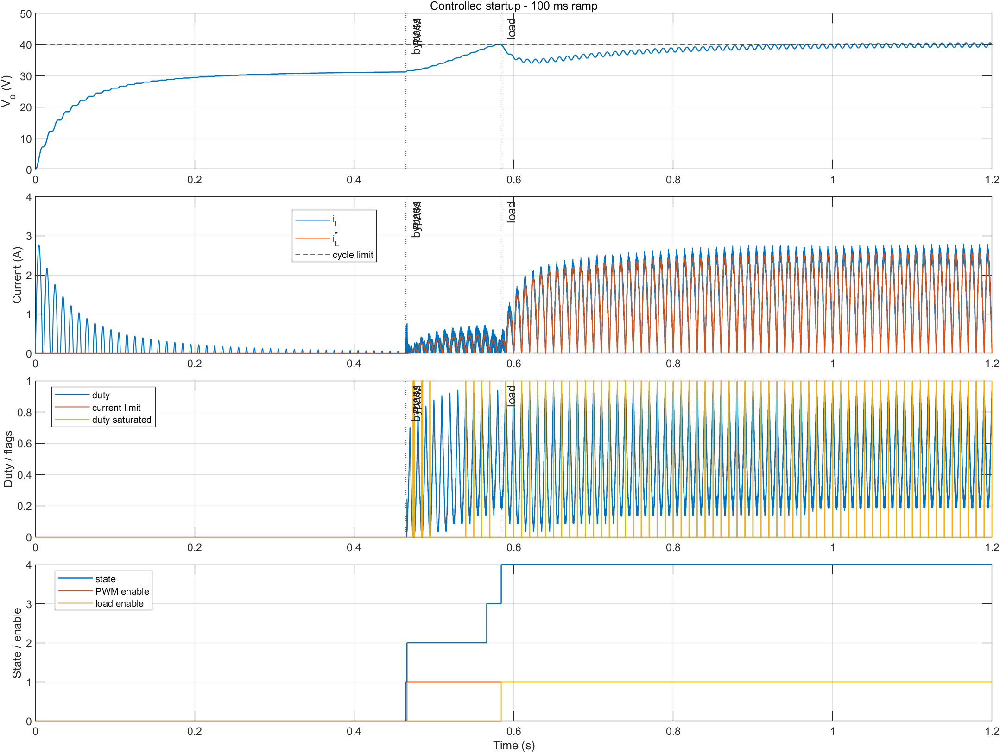
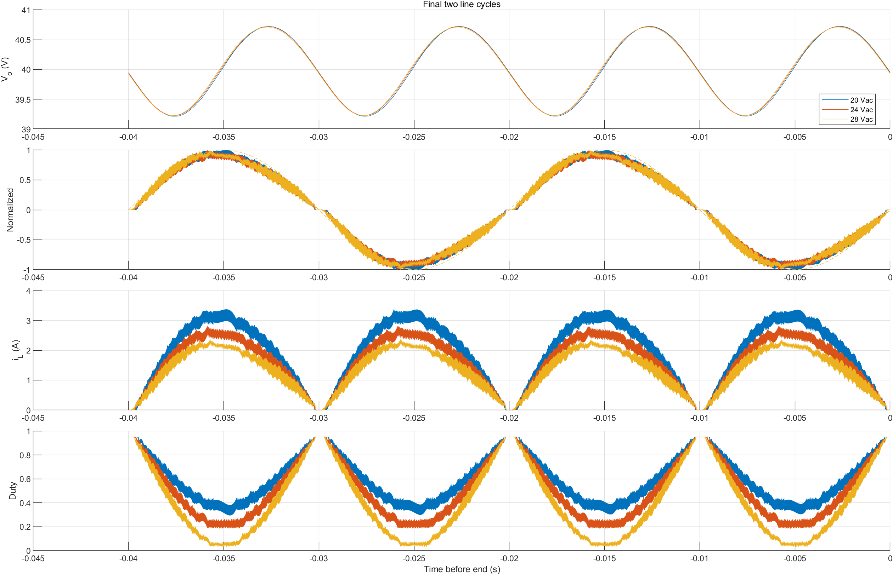
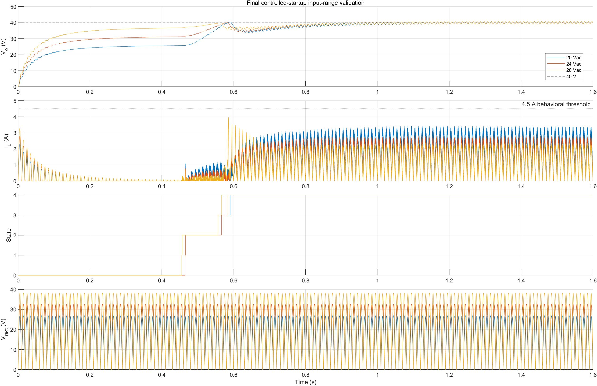
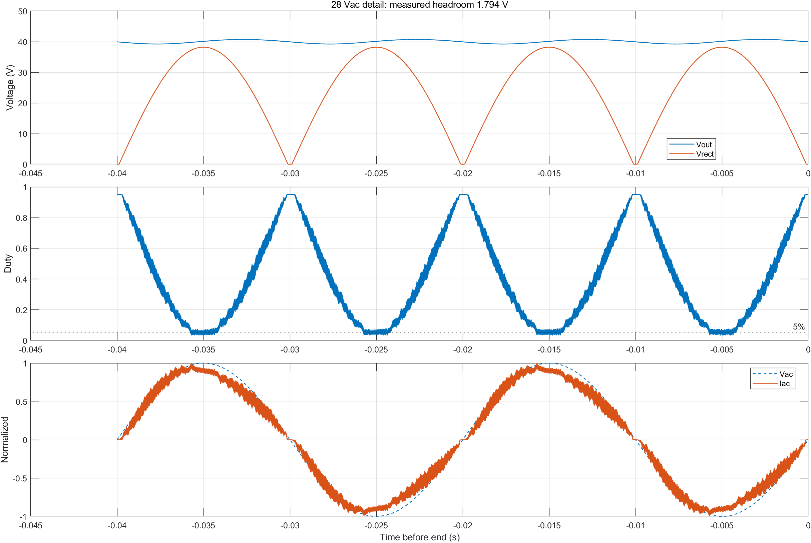
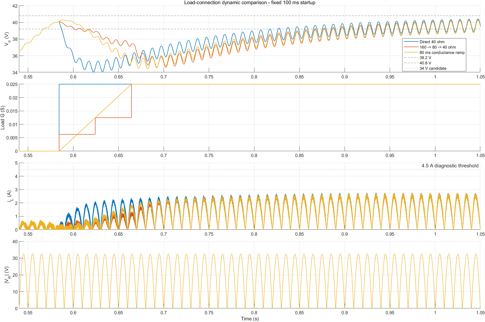
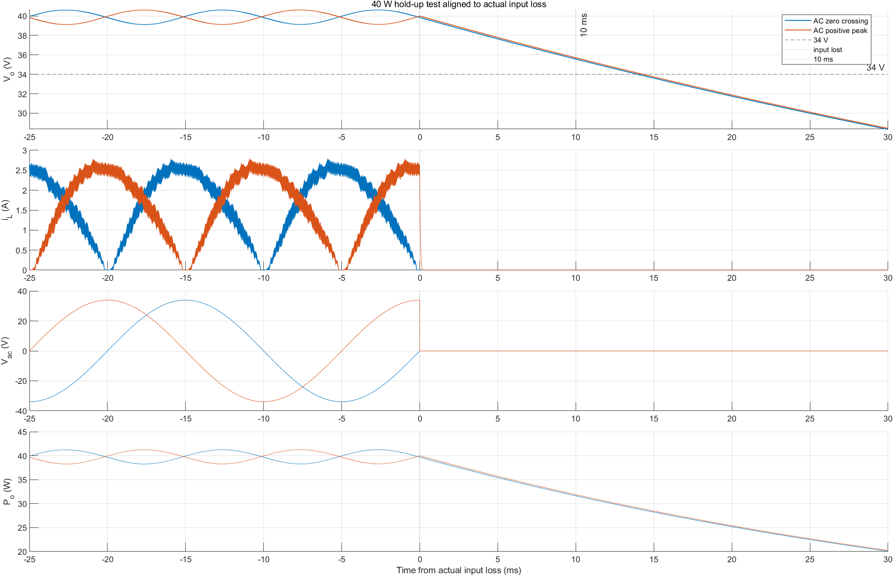
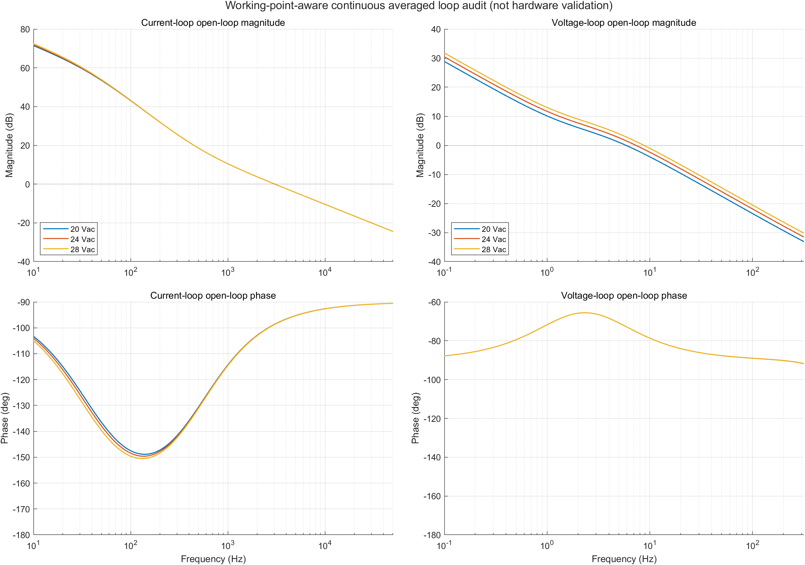

# 40 W CCM Boost PFC Simulink 仿真与验证报告

版本：2026-10-27。对象为**开关行为级软件模型**，不是硬件测试报告。本轮只复核既有脚本、MAT/JSON 和图片，未重新运行仿真。[模型设计记录](../../simulation/simulink/BoostPFC_Design/DESIGN_NOTES.md) 有旧阶段结果；下文优先采用最终 100 ms 软启动、直接 40 Ω 接载的 [输入范围原始结果目录](../../simulation/simulink/BoostPFC_Design/results/final_input_range/)。

## 1. 模型与复现入口

| 目的 | 实际文件 | 作用 |
|---|---|---|
| 初版设计 | [BoostPFC_Design.slx](../../simulation/simulink/BoostPFC_Design/BoostPFC_Design.slx) | 独立搭建的早期行为级模型，保留启动失败和基础工况证据 |
| 组合启动 | [BoostPFC_Design_ControlledStartup.slx](../../simulation/simulink/BoostPFC_Design/BoostPFC_Design_ControlledStartup.slx) | 条件旁路、PWM 软启动、故障/超时状态和延迟接载 |
| 最终输入范围基线 | [BoostPFC_Design_LoadConnection.slx](../../simulation/simulink/BoostPFC_Design/BoostPFC_Design_LoadConnection.slx) | 冻结 100 ms 斜坡和直接接入 40 Ω；20/24/28 Vac 只改变输入幅值 |
| 参数 | [BoostPFC_Design_Init.m](../../simulation/simulink/BoostPFC_Design/BoostPFC_Design_Init.m)、[ControlledStartup_Init.m](../../simulation/simulink/BoostPFC_Design/BoostPFC_Design_ControlledStartup_Init.m)、[LoadConnection_Init.m](../../simulation/simulink/BoostPFC_Design/BoostPFC_Design_LoadConnection_Init.m) | 规格、元件假设、PI、阈值、接载策略 |
| 自动测试 | [Run_Final_Input_Range.m](../../simulation/simulink/BoostPFC_Design/Run_Final_Input_Range.m)、[Run_Hold_Up_Test.m](../../simulation/simulink/BoostPFC_Design/Run_Hold_Up_Test.m)、[BoostPFC_Design_LoopAudit.m](../../simulation/simulink/BoostPFC_Design/BoostPFC_Design_LoopAudit.m) | 导出 MAT、JSON、PNG；环路脚本只做分析，不修改冻结模型 |

检查 `.slx` 的实际配置：`BoostPFC_Design_LoadConnection` 用 `FixedStepDiscrete`，固定步长变量 `Ts_sim=1 µs`；模型 `InitFcn` 根据自己的文件路径执行 `BoostPFC_Design_LoadConnection_Init.m`，而非依赖 MATLAB 当前目录。初始化脚本链最终读取基本参数。此前 [干净会话边界重跑记录](../../simulation/simulink/BoostPFC_Design/results/final_input_range/clean_session_boundary_verification.json) 覆盖 20/28 Vac；本轮未复测。完整输入范围测试停止时间 1.6 s。

模型包括交流源、桥式整流、预充与旁路、Boost L/Q/D/C/负载；电压 PI、整流波形归一化与电流参考、电流 PI、占空比限幅、50 kHz PWM、软启动状态机、行为级电流抑制/故障。计算步长为一个开关周期的 1/20。行为导通假设为桥二极管每只 0.7 V、Boost 二极管 0.65 V、Q1 40 mΩ、L1 100 mΩ。它不能解析真实器件的关断尖峰、反向恢复、磁饱和、散热和 EMI。

## 2. 测量窗口及通过标准

[最终结果 JSON](../../simulation/simulink/BoostPFC_Design/results/final_input_range/final_input_range_summary.json) 明确：输出稳态平均采用最后 0.10 s；PF、功率和 THD 使用最后 0.20 s，即 10 个完整 50 Hz 工频周期；THD 求 2～40 次谐波 RMS 相对于基波 RMS，最高 2 kHz，**不是 IEC 合规测量**。PF 按 `mean(vac·iac)/(Vrms·Irms)`。纹波为稳态输出最大值减最小值。接载恢复用 20 ms 移动平均，要求进入 39.2～40.8 V 且连续保持 10 ms；此范围只定义**比较的测量方法**，并无正式恢复时间上限。

正式稳态门槛：`|Vout-40|/40≤2%`，`Vout_pp≤2 V`，`PF≥0.95`，`THD≤10%`。10 ms 掉电后 Vout≥34 V 是单独的保持时间规格。**34 V 不是接载瞬态硬门槛。**

## 3. 启动路径及负面基线

[历史启动比较](../../simulation/simulink/BoostPFC_Design/results/controlled_startup/all_startup_strategy_comparison.json) 与 [设计记录](../../simulation/simulink/BoostPFC_Design/DESIGN_NOTES.md) 保存了失败样本：无预充 33.9197 A；10 Ω/80 ms/接载 20.8622 A；10 Ω/200 ms/接载 20.0865 A；10 Ω/200 ms/预充期间断载 6.8753 A；单一电压合格判据 7.8732 A。最后方案同时采用相位/压差/电流条件式旁路和受控软启动，不能把改善归功于某一个变量。

最终冻结输入范围模型的旁路条件：预充电压达到理论被动上限的 98%，整流电压达到估算峰值的 98%，`|Vrect-Vout|≤1.5 V`，`iL≤0.25 A` 连续 0.2 ms；0.5 s 超时；随后等待电流衰减、启用 PWM、100 ms 参考斜坡，输出稳定后直接接入 40 Ω。三工况未触发行为级 4.0 A 周期抑制或 4.5 A 故障，状态机终态均为 4。保护分支被单独故障注入测试，但这不是硬件 OCP 试验。

**图 2　24 Vac / 100 ms 软启动既有波形。** 出自 [受控启动结果](../../simulation/simulink/BoostPFC_Design/results/controlled_startup/ramp_100ms_metrics.json)；此图片属于组合启动模型的 1.2 s 测试，下面输入范围表属于 LoadConnection 模型的 1.6 s 运行，不能混用其具体稳态平均值。

## 4. 最终 20/24/28 Vac 输入范围

| Vac RMS | 旁路 / PWM / 接载 (s) | 全程 iL 峰值 (A) | 接载后 Vout 最低 (V) | 恢复时间 (s) | 稳态 Vout 均值 (V) | Vpp (V) | PF | THD 2～40 (%) |
|---:|---|---:|---:|---:|---:|---:|---:|---:|
| 20 | 0.465091 / 0.466291 / 0.592110 | 3.4209 | 33.6644 | 0.360489 | 39.9829 | 1.5213 | 0.99714 | 5.3722 |
| 24 | 0.464701 / 0.466194 / 0.584349 | 2.8351 | 34.0422 | 0.323389 | 39.9910 | 1.5035 | 0.99652 | 5.4714 |
| 28 | 0.455508 / 0.456708 / 0.566710 | 3.9677 | 35.4249 | 0.330622 | 39.9920 | 1.4910 | 0.99558 | 6.2925 |

表 1　最终行为模型输入范围结果。`iL` 峰值取**全 1.6 s 运行窗口**，不是仅稳态。恢复时间从接载事件计至上述 20 ms 移动平均重新进入 ±2% 范围并保持 10 ms。原始数据为同目录 `20Vac_raw_results.mat`、`24Vac_raw_results.mat`、`28Vac_raw_results.mat`，结构化值见 [汇总 JSON](../../simulation/simulink/BoostPFC_Design/results/final_input_range/final_input_range_summary.json)。三工况的四个正式稳态指标均通过；接载最低值/恢复没有正式阈值，不标通过或未通过。

**图 3　输入范围稳态波形。** [原图来源](../../simulation/simulink/BoostPFC_Design/results/final_input_range/input_range_steady_comparison.png)。

**图 4　输入范围启动与接载波形。** [原图来源](../../simulation/simulink/BoostPFC_Design/results/final_input_range/input_range_startup_comparison.png)。

28 Vac 的模拟整流峰值约 38.198 V，稳态升压余量约 1.794 V，线峰平均占空比 5.369%、最低 3.221%。全启动 iL 峰值 3.9677 A，逼近模型的 4.0 A 周期抑制设定，但记录中未触发。THD 高于 20/24 Vac；[专项波形](../../simulation/simulink/BoostPFC_Design/results/final_input_range/28Vac_headroom_and_waveform_detail.png) 显示失真不能简单归因于仅线峰的狭窄区间。器件级压降、寄生、电流采样和最小脉宽未纳入，不能据此宣布 28 Vac 硬件可靠。

**图 5　28 Vac 边界工况详图。** 结论只适用于当前行为模型。

## 5. 负载动态与输入掉电

24 Vac 下相同接载相位的三种测试见 [负载研究 JSON](../../simulation/simulink/BoostPFC_Design/results/load_connection_study/load_connection_summary.json)：直接接 40 Ω 最低 34.0422 V、从负载使能至恢复 0.323389 s；160→80→40 Ω 最低 34.5923 V、恢复 0.379346 s；80 ms 电导斜坡最低 34.4259 V、恢复 0.367662 s。分级/斜坡稍抬高最低电压，但按统一起点计恢复更慢，故维持直接接载。34 V/0.35 s 在该研究里只是**候选比较标准**，不是正式产品规格。另有早期 80→40 Ω 与 40→80 Ω 负载阶跃 [JSON](../../simulation/simulink/BoostPFC_Design/results/load_step_metrics.json)，与最终状态机接载研究不可混称同一场景。

**图 6　负载接入策略的既有仿真波形。** 该比较支持选定直接接载，不构成实物动态性能认证。

掉电测试用独立 [HoldUpTest 模型](../../simulation/simulink/BoostPFC_Design/BoostPFC_Design_HoldUpTest.slx) 在 24 Vac/40 Ω、状态机到运行态后切断交流输入。起点是测得交流及整流输入均真正归零并持续确认的时刻，而不是脚本命令时刻。[原始结果](../../simulation/simulink/BoostPFC_Design/results/hold_up_test/hold_up_summary.json)：零交越掉电前 20 ms 平均 39.8894 V，+10 ms 为 35.5683 V，至 34 V 为 13.969 ms；正峰值掉电前均值 39.8932 V，+10 ms 为 35.7036 V，至 34 V 为 14.303 ms。两者在模型内满足 10 ms/34 V 要求。负载为恒 40 Ω，电容 ESR/ESL、容量负容差未建模。

**图 7　24 Vac 稳态掉电保持波形。** 曲线与理想恒功率计算、恒电阻计算的区别见 [电源设计报告](02_电源设计与实现报告.md)。

## 6. 控制稳定性与效率边界

[环路审查](../../simulation/simulink/BoostPFC_Design/results/loop_audit/loop_audit_summary.json) 采用**连续平均、小信号、未饱和**模型，20/24/28 Vac 电流环交越约 3038.8/3039.4/3039.5 Hz，相位裕度约 81.39/81.35/81.31°；电压环交越约 5.858/7.324/8.754 Hz，相位裕度约 107.32/104.70/102.72°。该模型没有有限的 -180° 相位交越，故增益裕度不能填写有限数值。24 Vac 假设 0.5/1/1.5 个 PWM 周期延迟时，电流环相位裕度敏感性估算为 70.41/59.47/48.53°；**实际延迟未辨识**，不可当作离散实测裕度。

**图 8　开环 Bode 曲线。** 不能外推为硬件闭环已稳定，也不覆盖饱和、过零附近、开关寄生或故障状态。

早期 [额定结果](../../simulation/simulink/BoostPFC_Design/results/nominal_24Vac_metrics.json) 的端口功率比值约 92.82%，但 [理想器件对照](../../simulation/simulink/BoostPFC_Design/results/ideal_component_metrics.json) 出现 100.375% 的“效率”，暴露能量积分/离散对齐误差。本项目**不把 92.82% 写成已验证效率**。实物效率、PF、THD、温升、保护响应、EMI 皆未测量。

## 7. 待验证清单

离散采样/PWM/驱动延迟及闭环注入；28 Vac 小升压余量与器件压降/最小脉宽；L1 饱和、Q1 关断尖峰、D1 反向瞬态与散热；电容 ESR/容量负容差；完整能量平衡；硬件 OCP 动态阈值与上电复位时序。现有结果支持**软件模型内的指标判断**，不能推出硬件性能。

## 8. 与当前 RevB 工程的关系

本报告 PF、THD、纹波、启动电流和掉电保持数值均为**Simulink 行为模型结果**，未因 RevB 已完成的手工布线与覆铜而升级为实物数据。RevB 当前为 83 封装、557 走线、81 过孔、2 个 B.Cu 地 zone，静态 DRC 为 0 Error、0 未连接；[覆铜专项终审](../../hardware/BoostPFC_40W_KiCad/revb_ground_final_review_2026-10-27/REVB_GROUND_POUR_FINAL_REVIEW.md)给出 CONDITIONAL GO。仍无焊接、上电、效率、PF/THD、温升、EMI 或 VDS 尖峰实测。

