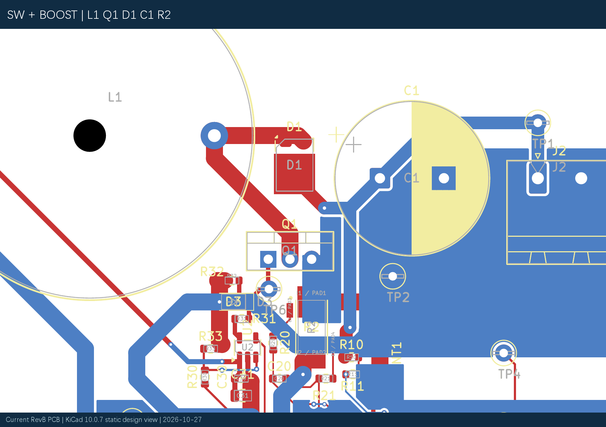
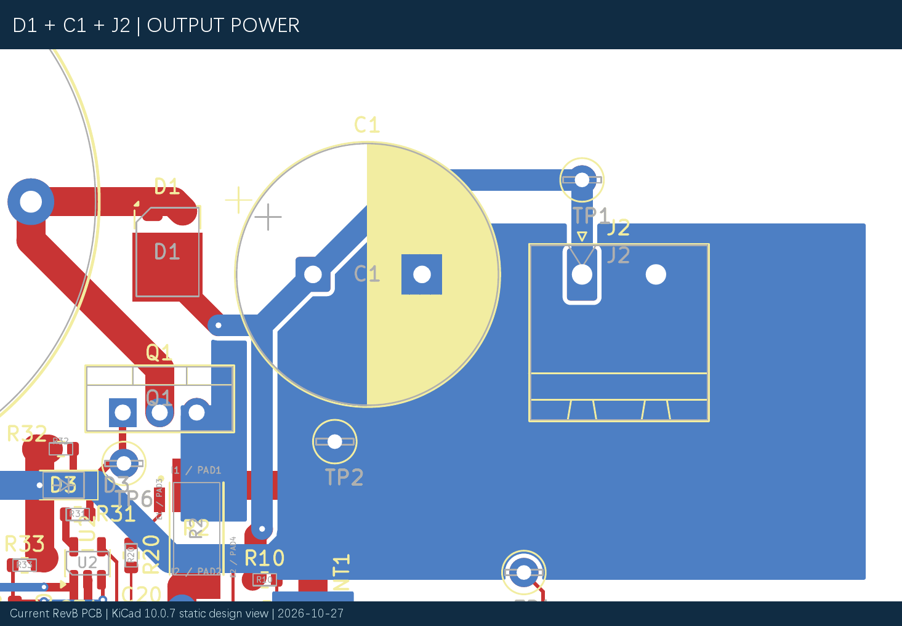
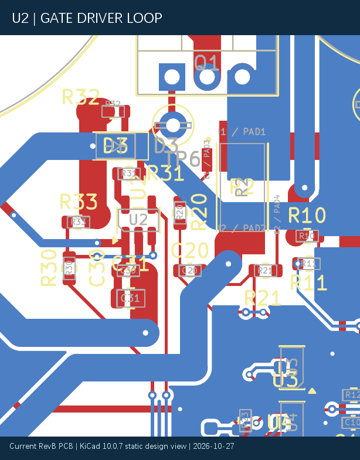
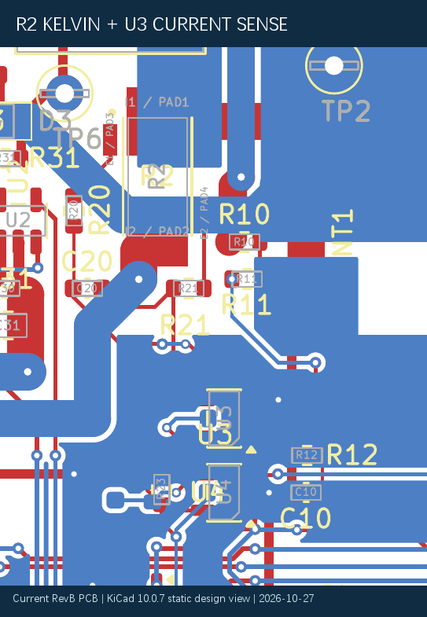
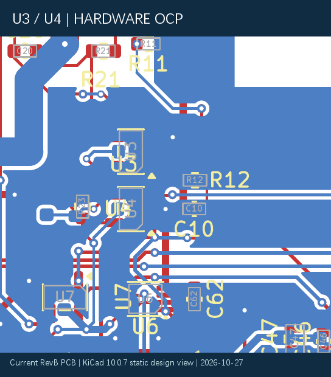
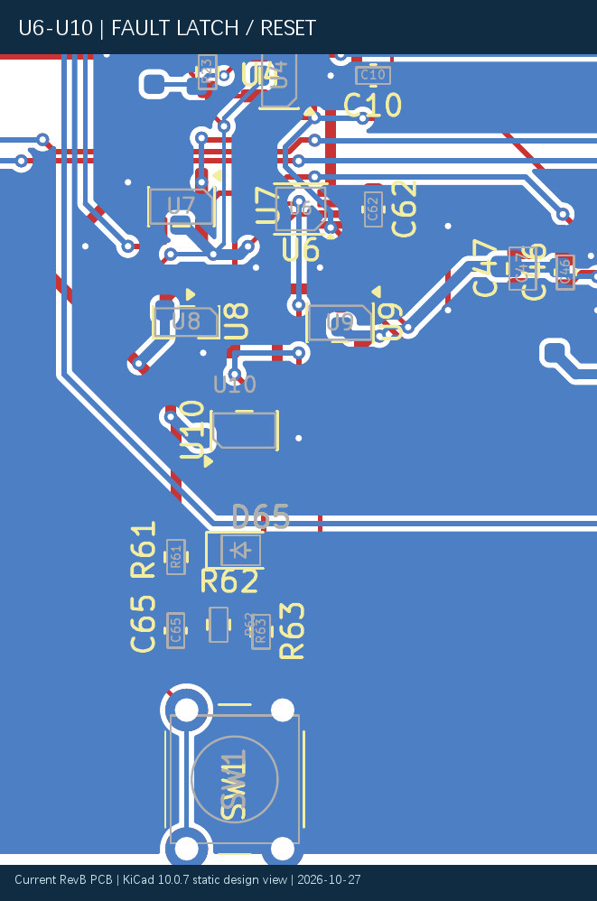
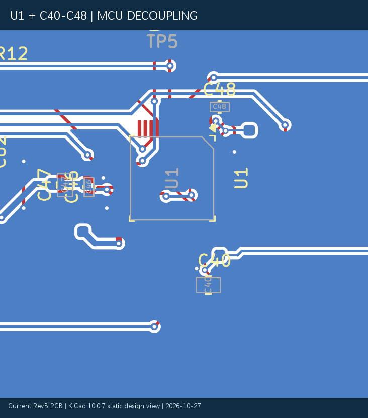
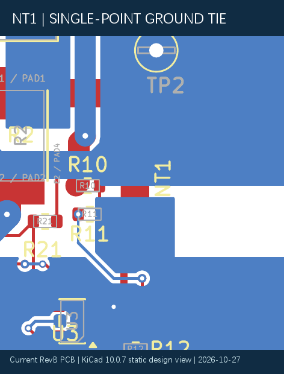
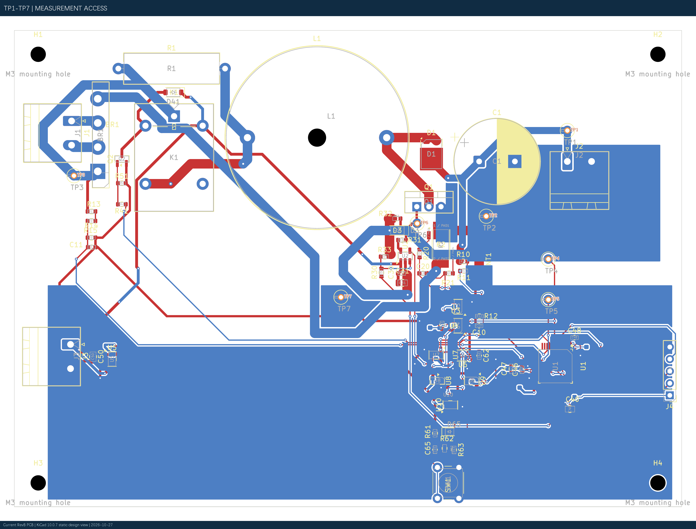
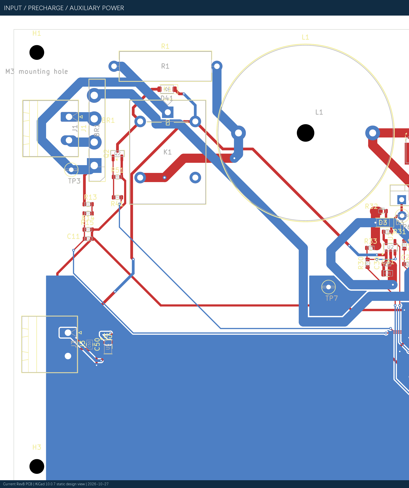

# 40 W Boost PFC PCB 设计、审查与制造资料：阶段版

**状态：RevA 历史资料 + 当前 RevB 手工布局布线及覆铜专项终审。** 本次只读取并审查 2026-10-27 已保存 RevB，未修改 PCB、原理图或制造包。RevB 已由项目本人完成主要功能模块器件摆放与全板手工布线，并建立 PGND/AGND 底层分区覆铜。覆铜静态专项终审为 CONDITIONAL GO：可进入最终丝印整理与新版 Gerber/Excellon 本地 CAM 审查，尚未批准直接下单。

## 1. 实际版本链

| 版本 | 文件及历史 SHA-256 | 已有证据 | 适用性 |
|---|---|---|---|
| 原始 RevA | [PCB](../../hardware/BoostPFC_40W_KiCad/pcb_revA_2026-10-26/BoostPFC_40W_RevA.kicad_pcb)，`9ACD8D105D5BD511DDBE1D59DF5CEC9363907E55A189DC73AFD46B4894D8FC8C` | 作为回滚基线，存在主功率回流、机械及 SW1 网络等问题 | 不用于制造 |
| RevA auditfix | [PCB](../../hardware/BoostPFC_40W_KiCad/pcb_revA_2026-10-26_auditfix/BoostPFC_40W_RevA.kicad_pcb)，`C3F55E566234E1DE423A98AF3148681D08A10FFB29FF4D54D7417758B3E4BD44` | [六阶段报告](../../hardware/BoostPFC_40W_KiCad/pcb_revA_2026-10-26_auditfix/AUDITFIX_REPORT.md) | 后经交叉审查发现 D1 P0 焊盘映射错误，**禁止使用** |
| RevA d1fix：历史 CAM 来源 | [PCB](../../hardware/BoostPFC_40W_KiCad/pcb_revA_2026-10-26_d1fix/BoostPFC_40W_RevA.kicad_pcb)，历史导出时 `4211E9DF06098E6FA2BED0AC7E004A335E32B6A38127F3201B78B79D06F2B325` | [D1 修复报告](../../hardware/BoostPFC_40W_KiCad/pcb_revA_2026-10-26_d1fix/D1_FIX_REPORT.md)、[第三轮独立审查](../../hardware/BoostPFC_40W_KiCad/independent_final_review_opus_2026-10-26/INDEPENDENT_FINAL_REVIEW_OPUS.md) | 当时被允许导出制造文件；当前磁盘文件哈希已不同，见下文 |
| RevB 手工 PCB | [当前工程](../../hardware/BoostPFC_40W_KiCad/pcb_revB_manual_layout_modular/BoostPFC_40W_RevB_ManualLayout.kicad_pcb) | 83 封装、557 走线、81 过孔、B.Cu PGND/AGND 两 zone、0 未连接 | **静态审查 CONDITIONAL GO；RevB 制造文件尚未生成** |

源原理图到 PCB 的流程：先建立器件及项目本地符号/封装，核对 L1 专用通孔封装、R2 四端 Kelvin 封装，导出网表并做 ERC；再同步封装与网络、人工检查功率回路、AGND/PGND、Kelvin、保护路径和机械间距；最后 DRC、独立审查与制造导出。详见 [封装验证](../../hardware/BoostPFC_40W_KiCad/prelayout_convergence/FOOTPRINT_VERIFICATION.md) 和 [网表验证](../../hardware/BoostPFC_40W_KiCad/prelayout_convergence/NETLIST_VALIDATION.md)。

## 2. 已记录的 RevA 修改与检查

[六阶段修复报告](../../hardware/BoostPFC_40W_KiCad/pcb_revA_2026-10-26_auditfix/AUDITFIX_REPORT.md) 记录：加宽 `/PGND` 回流并新增 R2.1 过孔阵列；扩展 `/AGND` 区并经 NT1 单点连接；将 SW/VOUT 功率主干置于顶层、缩短 Q1–D1–C1 换流路径；R2 Kelvin 线绕开分流器本体，OC_RAW/ISENSE_ADC 主路径缩短；调整 L1、C1、J2、K1 周边间距；修复 SW1 四个物理焊盘的网络及丝印。该报告的 Stage 6 静态 DRC 为 0 违规/0 未连接，但**随后的交叉审查仍发现 D1 致命物理引脚错误**，说明 DRC=0 不能替代器件引脚图核对。

D1 是 ST `STPST10H100SF` PSMC/TO-277A：1、2 为内部相连阳极，3 为大阴极焊盘。旧 auditfix 板 D1.1=`/VOUT`、D1.2=`/SW`、D1.3 空网，焊上器件会内部短接 SW/VOUT。d1fix 使用独立三引脚原理图符号和正常“从原理图更新 PCB”流程，使 D1.1/2=`/SW`、D1.3=`/VOUT`，并只修 D1 局部铜线；[修复报告](../../hardware/BoostPFC_40W_KiCad/pcb_revA_2026-10-26_d1fix/D1_FIX_REPORT.md) 含前后映射、哈希和 DRC/ERC。第三轮独立审查在当时的 `4211...B325` 文件上核对 226 个带编号铜焊盘、D1 三端、R2 串联主回流、NT1、硬件保护及机械范围，给出**仅允许进入 Gerber/CAM 的 CONDITIONAL GO**。

## 3. 历史制造包及本地 CAM

[制造报告](../../hardware/BoostPFC_40W_KiCad/manufacturing_release_revA_d1fix_2026-10-26/MANUFACTURING_RELEASE_REPORT.md)、[清单](../../hardware/BoostPFC_40W_KiCad/manufacturing_release_revA_d1fix_2026-10-26/GERBER_MANIFEST.md) 和 [本地 CAM 清单](../../hardware/BoostPFC_40W_KiCad/manufacturing_release_revA_d1fix_2026-10-26/CAM_REVIEW_CHECKLIST.md) 记录：KiCad 10.0.7 从**当时 SHA-256 为 `4211...B325` 的 d1fix PCB** 导出 7 个 Gerber、1 个 gbrjob、PTH/NPTH 两个 Excellon 文件；制造 ZIP 为 [BoostPFC_40W_RevA_D1Fix_BarePCB_CAM.zip](../../hardware/BoostPFC_40W_KiCad/manufacturing_release_revA_d1fix_2026-10-26/BoostPFC_40W_RevA_D1Fix_BarePCB_CAM.zip)，本轮复核其 SHA-256 仍为 `E71DFA70495349427E89AAC0A701BA4FF8E058A6604B99B379DCF5122E8FEDED`。

历史 CAM 解析结果：140×100 mm 闭合矩形板框；226/226 铜焊盘的 X2 网络/坐标与**历史导出时 PCB** 相符；D1 三端映射正确；前 224、背 40 个需要开窗的焊盘中心在阻焊开窗内；PTH 119、NPTH 5 与当时设计一致。详情与限制见 [CAM 原始 JSON](../../hardware/BoostPFC_40W_KiCad/manufacturing_release_revA_d1fix_2026-10-26/checks/cam_audit_result.json)。导出前后记录的 DRC 0 违规/0 未连接，ERC 0 Error/4 既有库缓存 Warning，原理图一致性另有 99 条元数据提示。报告还记录 5 个既存 ignored checks；第三轮独立报告在另一检查口径下写 `ignored_checks=[]`，两者**口径或版本差异待核**，不应简单写成“全部检查项零忽略”。

**图 1　RevA d1fix 历史 Gerber 本地 CAM 预览。** 该图不能替代嘉立创厂家工程审核或裸板电测。

## 4. RevB 人工布局、布线与覆铜：当前真实状态

**一句话：**RevB 已由项目本人完成主要功能模块器件摆放与全板手工布线，并建立 PGND/AGND 底层分区覆铜。覆铜静态专项终审为 CONDITIONAL GO：可进入最终丝印整理与新版 Gerber/Excellon 本地 CAM 审查，尚未批准直接下单。 这与历史 RevA 本地 CAM 结果是两个独立版本；不能混用结论。

| 对象 | 当前实际证据 |
|---|---|
| [RevB PCB](../../hardware/BoostPFC_40W_KiCad/pcb_revB_manual_layout_modular/BoostPFC_40W_RevB_ManualLayout.kicad_pcb) SHA-256 | `2BB23CBACD7A38E5F8491438F23DFACB0250224D6A2BCA3105C27D4691244414` |
| [RevB 原理图](../../hardware/BoostPFC_40W_KiCad/pcb_revB_manual_layout_modular/BoostPFC_40W_RevB_ManualLayout.kicad_sch) SHA-256 | `2C48EE15A7AB56400A25E550534BDA38973D15C336F68315AF6E2D29CF0975B0` |
| RevB 工程 `.kicad_pro` SHA-256 | `C0FD3749F61E2074AE71FF0E2F1B34CB35B4C61E5B0AA9E16F726896EB9365D6` |
| KiCad 10.0.7 只读盘点 | **83 封装、557 走线、81 过孔、2 zone、73 网络** |
| 完整 DRC：含 refill、parity、severity-all | **0 Error、34 Warning、0 Unconnected、4 parity Warning**。34 项分为 18 项 `silk_over_copper`、15 项 `silk_overlap`、1 项已排除的 `/RECT_IN` `via_dangling`；4 项为 H1–H4 PCB-only 机械孔。未隐藏或放宽规则 |

### 4.1 手工功能分区

本人对 J1/BR1/R1/K1 输入整流及预充、L1/Q1/D1/C1/R2/J2 Boost 功率级、U2 栅极驱动、U3/U4 采样与 OCP、U6–U10/SW1 故障锁存及人工复位、U1 MCU、J3/U5 辅助供电、TP1–TP7 测试点进行了模块化摆放和**全板手工布线**。工具用于 KiCad 规则检查、专项几何审查、文档和辅助验证；不能把人工摆件/布线写成自动生成。D1.1/D1.2 保持 `/SW` 阳极，D1.3 为 `/VOUT` 阴极。

**图 1　RevB 全板人工布局及布线（当前阶段）。** 当前 PCB 文件经 KiCad 图层导出；非 RevA Gerber，不代表制造放行。

**图 2　L1、Q1、D1 与 SW 高频区域。** `/SW` 在 F.Cu 由 5 段约 28.868 mm 中心线构成，B.Cu 无 SW 走线或 zone；不能据此推断开关过冲合格。

**图 3　D1、C1、J2 输出通道及功率回流。** PGND 左右填充块由既有顶层 2.00 mm 路径与贯通焊盘连接，并非一片连续底层面。

**图 4　U2 与 R31/R32/D3/C30/C31 栅极驱动区。** 走线几何可做静态检查，实际驱动尖峰仍需测量。

**图 5　R2 四端 Kelvin、R20/R21 与 U3。** R2.1=`/PGND`、R2.2=`/BRIDGE_NEG`；R2.3=`/ISENSE_P`、R2.4=`/ISENSE_N`。两采样路分别以 0.20 mm 线引出，不承载主功率回流；静态结论 CONDITIONAL，噪声与误差待实测。

**图 6　电流放大器/比较器 OCP 区。** 4.51 A 是名义比较阈值，非已验证的硬电感峰值钳位。

**图 7　U6–U10 与人工复位。** 硬件锁存的动态 POR 与故障响应仍缺实测。

**图 8　U1 与 C40–C48。** C40=4.7 µF bulk；C42=100 nF→VDD24/VSS23，C41=100 nF→VDD36/VSS35，C43=100 nF→VDD48/VSS47；C44=10 nF、C45=1 µF→VDDA/VSSA；C46=100 nF、C47=1 µF→VREF+/VSSA；C48=100 nF→VBAT。来自 [U1 去耦修订](../../hardware/BoostPFC_40W_KiCad/u1_decoupling_revision_2026-10-27/U1_DECOUPLING_REVISION_REPORT.md)。

**图 9　当前 B.Cu PGND/AGND 分区。** PGND 实际填充 991.809 mm²、AGND 4852.406 mm²；各有两个填充连通域，小区均有同网锚点，未发现死铜。最窄热路径与实际温升未实测。

**图 10　NT1 静态单点连接。** NT1.1=`/PGND` (107.5,56.0) mm，NT1.2=`/AGND` (107.5,60.0) mm；两底层填充区布尔交集 0 mm²，未发现第二跨地铜桥。结论仅限静态网络/几何。

**图 11　TP1–TP7 位置标注。** 标注来自实际 PCB 焊盘坐标；测量可达性还需探头及装配检查。

**图 12　输入整流/预充与 12 V→3.3 V 辅助电源布局。** 不是电气功能实测。

### 4.2 地铜、网络类与制造前判断

PCB 已配置 POWER_3A 2.00 mm、POWER_1A 1.50 mm、AUX_POWER 0.60 mm、POWER_3V3/GATE 0.50 mm、SIGNAL/ANALOG 0.25 mm、KELVIN 0.20 mm、`/SW` 2.00 mm 且 clearance 0.50 mm；其他间距与过孔预设见 [网络类报告](../../hardware/BoostPFC_40W_KiCad/revb_netclass_rules_2026-10-27/REVB_NETCLASS_RULES_REPORT.md)。这只是配置，必须以实际线宽、铜颈、载流与制造检查为准。

[覆铜专项终审](../../hardware/BoostPFC_40W_KiCad/revb_ground_final_review_2026-10-27/REVB_GROUND_POUR_FINAL_REVIEW.md)独立检查 PGND/AGND 网络绑定、zone 实际填充、NT1、SW 下方避空与 R2 Kelvin。NT1 静态单点连接 **PASS**；Kelvin 为 **CONDITIONAL**；C46.2 下方无直接 B.Cu 填充，但由约 1.2 mm F.Cu 到 AGND 过孔；PGND 主回流底层有分割，靠 2.00 mm 顶层主干贯通。DRC 0 Error、0 Unconnected 仅为 KiCad 静态检查。结论是 **CONDITIONAL GO**：允许下一步丝印整理与 Gerber/Excellon 生成后的本地 CAM，不代表批准下单，也不等于硬件已通过。

## 5. 当前未完成与制造文件门槛

先处置 34 条 DRC Warning：其中 18 条丝印压铜、15 条丝印互叠、1 条坐标 `(42.8,42.2) mm` 的历史 `/RECT_IN` 已排除 dangling via，不能仅因 excluded 就忽略。H1–H4 四个 PCB-only M3 安装孔为预期机械一致性 Warning。检查 C46 局部 AGND 回流、PGND 分割后的实际温升裕量、器件本体/接线空间、主功率回流与 SW/采样耦合。之后复跑 DRC、独立审查并从**最新 RevB 哈希**生成 Gerber/Excellon，执行本地 CAM 与厂家审核。旧 RevA 制造包不能用于 RevB。

尚无 RevB Gerber/CAM、厂家审核、订单、裸板、焊接或实物上电；也无硬件效率、PF/THD、温升、EMI、VDS 尖峰和保护动态实测。当前阶段仅静态设计审查有条件通过。历史 [RevA 在线报价](../../hardware/BoostPFC_40W_KiCad/manufacturing_release_revA_d1fix_2026-10-26/JLCPCB_BARE_BOARD_QUOTE.md)不是当前 RevB 实时报价或最终付款额。

