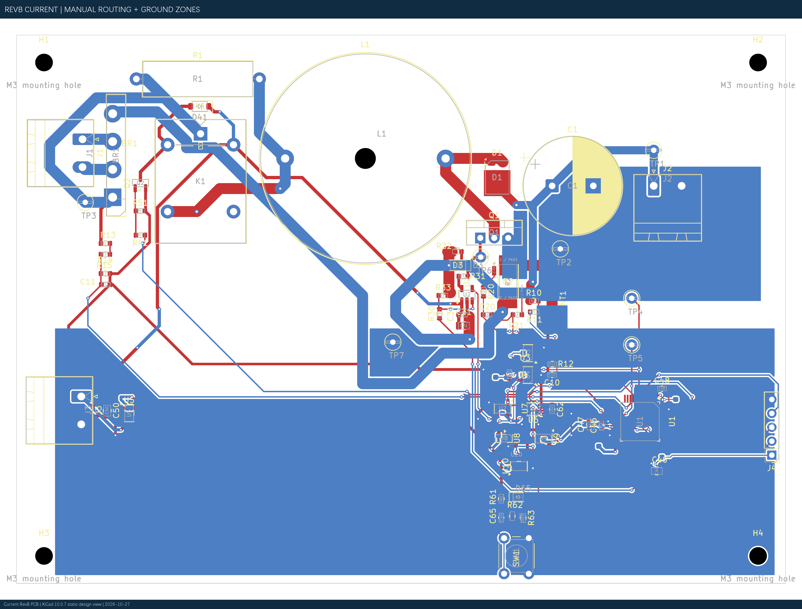

# 当前 RevB 完整工程：手工 PCB + 导线模块化原理图

这是当前推荐打开的完整 KiCad 工程。PCB 保留用户本人完成的器件布局、手工走线、过孔及 PGND/AGND 覆铜；配套原理图采用模块内导线连接、模块间网络标号的阅读方式。

**通过 KiCad 工程管理器打开 `BoostPFC_40W_RevB.kicad_pro`。** 原理图与 PCB 使用同一文件名，均包含在本目录。没有重新摆放器件、重新布线或变更电路。

- [10 页中文模块导线学习图册](BoostPFC_40W_模块导线学习图册.pdf)
- [项目关联与全板焊盘检查](checks/combined_project_check.json)
- [完整 DRC / 原理图一致性](checks/combined_drc.json)
- [ERC](checks/combined_erc.json)

## 最新 PCB

## 配套可读原理图

## 一致性与版本

- PCB：83 个封装、557 段走线、81 个过孔、2 个地覆铜区。PCB SHA-256：`2BB23CBACD7A38E5F8491438F23DFACB0250224D6A2BCA3105C27D4691244414`，与用户手工工程逐字节相同。
- 原理图：仅更改画法和独立项目名；与原 RevB 的 238 个引脚网表 0 电气差异。SCH SHA-256：`5A9EFBDB628A532EC28CAE649ACE53BCD4E28574CD3926B32C63743337EF62EC`。
- 全板 240 个带编号物理焊盘核对：0 网络差异。D1 双阳极=/SW、阴极=/VOUT；R2 Kelvin 和 NT1 关系保持。
- KiCad 10.0.7：DRC 0 Error / 34 个原有 Warning，Unconnected 0。34 项为 15 条丝印重叠、18 条丝印压铜、1 条已排除的旧 RECT_IN 悬空过孔。
- 原理图一致性只有 H1–H4 四个 PCB-only 安装孔提示；ERC 0 Error / 4 个原有库缓存 Warning。

这是当前工程展示与后续编辑的整合副本。历史 `hardware/revb/` 和独立读图 `hardware/learning/` 保留供追溯。制造放行、厂家审图及实物电气验证状态仍需分别确认；本次合并未生成制造文件或执行采购。
