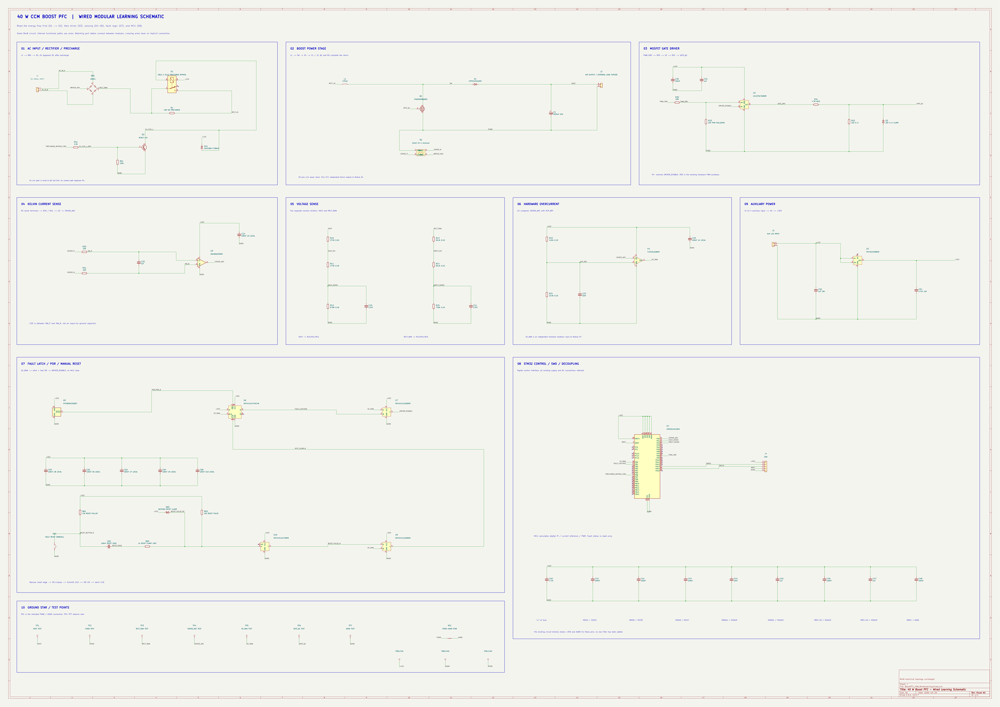

# 模块内导线原理图学习版（2026-10-29）

本版以 `../revb/` 的 RevB 原理图为依据，只整理画法。模块内部尽量采用导线，模块之间保留原网络标号；供电、地和重复 OC_RAW 扇出保留短标号以减少交叉。

- **[10 页中文模块图册](BoostPFC_40W_模块导线学习图册.pdf)**：每页一块电路，附中文阅读提示。
- [完整 A0 矢量原理图](previews/BoostPFC_40W_WiredLearning.pdf)。
- KiCad 工程入口：`BoostPFC_40W_WiredLearning.kicad_pro`。
- [逐引脚核查结果](checks/electrical_comparison.json)。

## 模块与阅读顺序

1. 交流输入、整流与预充；
2. Boost 功率级；
3. MOSFET Gate Driver；
4. Kelvin 电流采样；
5. 输出和整流输入电压采样；
6. 硬件过流比较器；
7. 故障锁存、POR、人工复位；
8. STM32 / SWD / C40–C48 去耦；
9. 辅助 12 V → 3.3 V；
10. NT1 地单点连接与 TP1–TP7。

## 核查结果

- 79 个实际器件、82 个含 PWR_FLAG 的符号实例、238 个引脚均保持。
- 引脚网表、器件值、封装、库关联及符号属性：**0 电气差异**。
- 导线由 0 增至 294 段；网络标号由 208 减至 108。
- KiCad 10.0.7 ERC：0 Error、4 条源图原有库缓存 Warning；没有新警告或规则放宽。
- D1.1/D1.2=/SW，D1.3=/VOUT；R2 四端与 NT1 网络保持。
- 学习版 SCH SHA-256：`8984DEDD7FA9FD3DFAC7ED49E49D22FB1470243785F404B20B936E4267068C11`。

本目录是独立读图学习工程，不能直接作为 RevB PCB 的更新来源。去耦电容在图中沿母线排列便于阅读；PCB 中仍需各自靠近对应电源脚。原 RevB 工程与 PCB 未修改。

**Electrical topology unchanged. This revision contains schematic presentation/layout changes only.**
